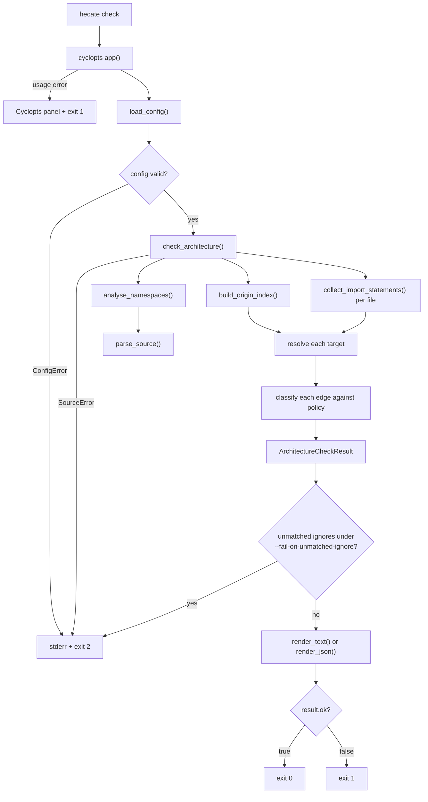

# Hecate developers' guide

This guide records the internal design, test strategy, and tooling conventions
for maintaining Hecate. It is written for contributors changing the checker
itself, rather than for projects adopting it: behaviour visible to users is
documented in the [users' guide](users-guide.md), and the configuration surface
is documented in the [configuration reference](configuration.md).

The guide describes verified behaviour of the code on the branch that carries
it. Where a mechanism has a deliberate limit, the limit is stated rather than
implied, because most of Hecate's design follows from deciding what static
analysis can and cannot know.

## Related documents

- [AGENTS.md](../AGENTS.md) holds the coding, testing, and commit conventions
  that apply to every change. This guide does not restate them.
- [ADR 001](adr-001-stdlib-ast-import-engine.md) records why the standard
  library `ast` module is the v1 engine, and catalogues its limitations.
- [ADR 002: four-tier Python commit-gate linting](
  adr-002-four-tier-python-linting.md) records the lint tiers and the Skylos
  dead-code gate.
- [ADR 002: adopt the shared CV-005 contract library](
  adr-002-adopt-the-shared-cv005-contract-library.md) records the
  coverage-workflow contract decision.
- [Local validation of GitHub Actions](
  local-validation-of-github-actions-with-act-and-pytest.md) covers black-box
  workflow testing with `act`.
- [Documentation style guide](documentation-style-guide.md) governs prose,
  Markdown, and diagram conventions.
- [Scripting standards](scripting-standards.md) covers `uv`-scripted tooling.

There are two ADR 002 files, for unrelated decisions. That collision is
deliberate for now and changes nothing about how either is referenced.

## Architecture

Hecate is a batch command-line tool rather than a service. One invocation loads
a TOML policy, scans every configured package root, classifies each import edge
it can explain, renders a deterministic report, and exits with a code that a
Continuous Integration (CI) job can act on. There is no daemon, no network
access, and no import execution: the analysis engine parses source text and
never runs it.

The design separates four concerns so that another engine could replace the
parser without changing the TOML policy schema:

- **parsing**, which turns source text into syntax trees (`source.py`,
  `imports.py`);
- **namespace modelling**, which records what each module binds and exports
  (`module_scope.py`, `all_sequence.py`, `namespaces.py`);
- **provenance**, which resolves a written import target to the modules that
  supply it (`origins.py`);
- **policy**, which decides whether each resolved edge is allowed
  (`policy.py`, `checker.py`).

The engine choice, and the reasoning behind it, belongs to
[ADR 001](adr-001-stdlib-ast-import-engine.md).

### Execution flow

For screen readers: the following flowchart follows one `hecate check`
invocation from the command line to its exit code. The Cyclopts application
parses arguments and calls `load_config`, which discovers or reads the TOML
policy and applies command-line overrides. `check_architecture` then analyses
namespaces, builds the origin index over them, collects import statements, and
classifies each edge against policy. The resulting `ArchitectureCheckResult` is
rendered as text or JSON and turned into an exit code. A usage error leaves
this flow before `load_config` and exits 1.



_Figure 1: One `hecate check` invocation from argument parsing to exit code.
All three routes to exit code 2 converge on a single stderr node; a usage error
exits 1 through Cyclopts instead, as described under
[Check outcome and exit codes](#check-outcome-and-exit-codes)._

### The stdlib `ast` import-analysis engine

`imports.py` collects `Import` and `ImportFrom` nodes from a parsed module and
converts them into `DirectImport` and `FromImport` records. Two helpers carry
the name arithmetic:

- `compute_module_name` derives a dotted module name from a source path under a
  package root, dropping `__init__` so that `pkg/__init__.py` becomes `pkg`;
- `relative_import_base` returns the absolute base module for a relative import
  level, accounting for whether the importing file is a package `__init__`.

`collect_import_statements` returns statements in source order. `ast.walk`
traverses the tree in no specified order, which stops matching source order as
soon as an import is nested inside a block, so collected nodes are sorted by
`(lineno, col_offset)` before conversion. Order matters because Python applies
last-binding-wins, and later analysis depends on being able to read the source
order back.

`FromImport.names` preserves `"*"` entries verbatim rather than filtering them,
so wildcard handling is decided by the code that understands wildcard
semantics, not by the collector.

Relative imports are resolved through `resolve_import_from`, which combines
`relative_import_base` with the written module. `relative_import_base` strips
`level - 1` components from the module name, and strips the module's own leaf
first unless the file is a package `__init__`, whose module name already
denotes the package. A bare `from . import name` therefore resolves to
`pkg.sub` both in `pkg/sub/mod.py` and in `pkg/sub/__init__.py`, while in
`pkg/sub/mod.py` a second dot would drop `sub` as well.

`ImportFrom` edges, nested imports, and `TYPE_CHECKING` imports need no special
case. A `from x import y` statement contributes an edge to `x` and, when `y` is
not a wildcard, an edge to `x.y`. Collection is syntactic, not an execution
model: `collect_import_statements` walks the whole tree, so an import is
recorded wherever it is written, including inside a branch, a `try`, a loop, a
`with`, a `match` case, a function, or a class. Such an import may never run —
an `if` body can be skipped, no `match` case needs to match, and a function
body runs only when called — so Hecate treats it as a possible source-level
dependency rather than a certain one. An import inside a `TYPE_CHECKING` block
is reported on the same footing, because the dependency exists in the source
even though the guard is false at runtime.

### Bindings and wildcard exports

These are separate concepts and must stay separate. A module **binds** a name
when it defines or imports it; `from module import name` reaches every binding.
A module **exports to wildcards** the names `__all__` selects, or its public
bindings when `__all__` is absent. `__all__` governs only the wildcard
selection: it never unbinds a name, so an explicitly imported re-export keeps
its origin even when `__all__` omits it or is set to `[]`. Filtering bindings
through `__all__` produces false negatives, letting a re-export evade a
boundary rule. A name `__all__` selects but no binding supplies stays in the
export set so normal resolution reports it unresolved, matching the
`AttributeError` Python raises.

`module_scope.py` answers only which statements run at module scope: an `if`,
`try`, loop, `with`, or `match` body still executes at import time, so its
bindings count, while `def`, `async def`, and `class` bodies open a local scope
and are not traversed. That exclusion is about bindings only; import collection
uses a whole-tree walk, as described above. `module_scope.py`'s nesting flag
separates a statement that always runs from one that may not, which
`all_sequence.py` and `namespaces.py` read when deciding whether a later
assignment replaces an earlier one or only adds a possibility.

A binding executed unconditionally supersedes every earlier candidate for its
name, because no execution path can still reach them. A binding inside a
control-flow block only adds a candidate, because which branch ran decides the
name's value. A `for` target is treated as conditional even though the loop
statement itself is at module level: an empty iterable leaves the name unbound.
`ModuleNamespace.bindings` is therefore a multimap keyed by name, and
provenance reports every origin a name may hold rather than one winner.

`all_sequence.py` evaluates the `__all__` sequence statically. A literal
assignment such as `__all__ = ["A", "B"]` is read exactly; `__all__ += [...]`
extends a sequence that is still known; and anything the evaluator cannot
follow leaves the sequence unknowable, which the caller reads as "fall back to
the default public-name rule". An empty selection is a real answer, distinct
from an unknown one, so `__all__ = []` exports nothing rather than reverting to
the public-name rule. A method call such as `__all__.extend(...)`, a subscript
store such as `__all__[0] = ...`, a `del`, and an unpacking target all clear
the evaluator's knowledge, because a stale literal value could hide a name the
mutation added.

`origins.py` layers provenance over the namespace model. `build_origin_index`
builds an `OriginIndex` over already-analysed namespaces; `origins_for` maps
one written target to every module that plausibly supplies it, following
re-export chains, and `wildcard_exports` lists the concrete origins a star
import would bind. `Resolution` records how far a target was resolved:
`RESOLVED`, `UNRESOLVED_INTERNAL`, or `EXTERNAL`. An unresolved target is
classified rather than dropped, so policy can tell "no dependency exists" from
"Hecate could not tell".

Re-export handling follows from that model rather than from a separate module.
`hecate/reexports.py` no longer exists; its responsibilities are split between
`namespaces.py` (bindings and wildcard selection) and `origins.py` (provenance
over them). The observable behaviour is documented in the
[users' guide](users-guide.md#re-export-handling), and the policy schema in the
[configuration reference](configuration.md).

### Decision order for one import edge

An import statement is expanded into edges before policy sees it.
`_evaluate_statement` in `checker.py` fixes that expansion:

1. A `FromImport` first contributes an edge for its written target, which is
   what reports an export set Hecate could not resolve.
2. A statement with no `"*"` name contributes an edge per named target, so
   `from x import y, z` yields edges for `x.y` and `x.z`.
3. A statement with `"*"` contributes an edge per statically known exported
   origin instead. Python permits no further names beside `*`, so no per-name
   edges belong here.
4. When a `from` statement's target is internally unresolvable, a named edge
   that is unresolvable for that same reason is skipped, because both edges
   would report one broken import twice. A symbol that resolves despite its
   parent is still reported, because it is a real dependency.

Each expanded origin is then classified by `_classify_origin`, which fixes this
decision order and applies the first match:

1. Resolve the imported target, and look up the configured group for both the
   importer and the imported module.
2. An `EXTERNAL` target is out of scope unless `include_external_packages` is
   enabled _and_ a configured group claims its prefix. The option widens what
   can be classified; it does not assert that a runtime reference was migrated.
   Without this rule, every standard-library import would become an
   unclassified failure once strict mode met external packages.
3. An `UNRESOLVED_INTERNAL` target is checked against the ignore list. A
   documented ignore exempts it; otherwise a coverage diagnostic is recorded
   with state `unresolved`, at the severity `coverage_severity` returns.
4. An edge with an unclassified endpoint is checked against the ignore list,
   and otherwise recorded with state `unclassified`.
5. An edge whose importer group is allowed to import the target group is
   permitted and recorded nowhere, because an absent diagnostic means permitted
   rather than unexamined.
6. A remaining edge is checked against the ignore list; a match records it as
   exempted.
7. Anything still unmatched is a violation of `default_rule_id`.

Ignoring is therefore applied on two branches rather than one: the coverage
branch, so an edge the policy could not classify or resolve stays exemptible,
and the forbidden branch, after the allowed-check and before the violation is
recorded. An exempted edge is reported through the ignore list rather than
discarded, which is what lets `--fail-on-unmatched-ignore` tell that an entry
applied. Every in-scope edge receives exactly one of `permitted`, `forbidden`,
`exempted`, `unclassified`, or `unresolved`.

Deduplication keeps the report stable when several statements or several
re-export chains reach one edge. Violations are keyed by
`(rule_id, importer, imported, line)`, ignored imports by
`(importer, imported)`, and coverage diagnostics by
`(state, importer, imported, source_path, line)`. The result sorts violations
and coverage by their identity tuple and ignored imports by their rendered
line, so two runs over unchanged source produce byte-identical output.

### Check outcome and exit codes

`ArchitectureCheckResult.ok` is true only when there are no violations _and_ no
coverage diagnostic carries error severity. A green result therefore means no
forbidden edge was found and no coverage failure occurred; it does not claim
every edge was understood. Outside strict mode, unclassified and unresolved
edges are warnings, so a non-strict run can pass while recording them. Under
strict mode both become failures, with unresolved internal edges using the
configured `unresolved_internal_severity`.

The process exit code follows from that outcome:

| Code | Meaning                                                                    |
| ---- | -------------------------------------------------------------------------- |
| 0    | The architecture check passed.                                             |
| 1    | Architecture violations, or coverage diagnostics at error severity, found. |
| 2    | Input validation failed: configuration or source problems.                 |

_Table 1: Process exit codes for `hecate check`._

Exit code 2 covers three distinct rejections, which the CLI distinguishes only
by the message on standard error:

- a `ConfigError`, from a missing or malformed configuration file or a failed
  validation rule;
- a `SourceError`, from a scanned file that could not be read as UTF-8 or is
  not valid Python; and
- an unmatched ignore under `--fail-on-unmatched-ignore`.

The last of these comes from `check` itself rather than from an exception: the
check runs after policy evaluation and returns before any rendering, so such a
run prints the unmatched entries to standard error and exits 2 without printing
the check result at all.

**A command-line usage error exits 1, not 2.** Cyclopts handles an unknown
option, an unknown command, or a value it cannot coerce by printing its own
error panel to standard error and calling `sys.exit(1)` inside `app()`, before
`main` regains control. The `except cyclopts.CycloptsError` branch in `main`
therefore never runs for a parse failure. That branch is only reachable when
`exit_on_error` is false, which this `App` does not set; with that setting the
parse error would propagate instead and the branch would return 2. The shipped
behaviour is Cyclopts's default, so a usage error is indistinguishable from an
architecture violation by exit code alone, and a caller that branches on the
code must read standard error as well. `cli.py`'s own docstring still claims
exit 2 for this case, so the docstring and the behaviour disagree.

### Static-analysis limits

These limits are properties of parsing source without executing it. They are
recorded here so that a surprising green result is investigated as a known
limit rather than as a new bug.

- **Dynamic imports are invisible.** `importlib.import_module(...)`,
  `__import__(...)`, and any computed module name produce no edge.
- **Non-literal `__all__` is unknowable.** The wildcard selection falls back to
  the public-name rule. Explicit imports are unaffected, because `__all__` does
  not govern them.
- **Star exports expand only when statically resolvable.** A wildcard whose
  export set cannot be resolved is reported as unresolved rather than
  approximated away.
- **External packages are classified by configured prefixes**, not by
  installed distribution metadata. Without `include_external_packages`,
  external edges are out of scope by configuration rather than absent from the
  analysis.
- **`__init__.py` re-export following is syntactic.** A re-export assigned
  through a call or a comprehension is a definition, not an import, and cannot
  be followed to its origin.

[ADR 001](adr-001-stdlib-ast-import-engine.md) records the rationale for
accepting these limits in v1 and the conditions under which another engine
would be introduced.

## Module layout

The `hecate` package is flat: every module sits directly under `hecate/`, and
each owns one concern. The layering runs from the two modules with no internal
dependencies, through the analysis stages, to the orchestration and rendering
modules at the top.

### Module responsibilities

| Module              | Responsibility                                                        | Imports internally                                                    |
| ------------------- | --------------------------------------------------------------------- | --------------------------------------------------------------------- |
| `module_scope.py`   | Yield the statements that run at module scope, with nesting flags.    | none                                                                  |
| `source.py`         | Read and parse one scanned file, reporting `SourceError`.             | none                                                                  |
| `all_sequence.py`   | Evaluate a module's `__all__` sequence, or report it unknowable.      | `module_scope`                                                        |
| `config_helpers.py` | Internal TOML readers and validators, reporting `ConfigError`.        | `policy`                                                              |
| `diagnostics.py`    | Hold the stable, ordered diagnostic dataclasses and their JSON forms. | `policy`                                                              |
| `imports.py`        | Collect `Import` and `ImportFrom` statements from source text.        | `source`                                                              |
| `policy.py`         | Classify edges against groups, allow-lists, and ignores.              | `imports`                                                             |
| `namespaces.py`     | Model bindings and wildcard exports per module.                       | `all_sequence`, `imports`, `module_scope`, `source`                   |
| `origins.py`        | Resolve an import target to the modules that supply it.               | `namespaces`                                                          |
| `config.py`         | Discover, parse, validate, and override the TOML configuration.       | `config_helpers`, `policy`                                            |
| `output.py`         | Render text and JSON output.                                          | `checker`                                                             |
| `checker.py`        | Orchestrate the traversal and assemble the result.                    | `config`, `diagnostics`, `imports`, `namespaces`, `origins`, `policy` |
| `cli.py`            | Define the Cyclopts application and translate failures to exit codes. | `checker`, `config`, `output`, `source`                               |
| `__init__.py`       | Publish the supported public API.                                     | `checker`, `cli`, `config`, `diagnostics`                             |
| `__main__.py`       | Run the CLI under `python -m hecate`.                                 | `cli`                                                                 |

_Table 2: Module responsibilities and internal dependencies._

Two modules are leaves, and the absence of a dependency is deliberate:
`module_scope.py` answers a question about the syntax tree, and `source.py`
owns the only filesystem and parser boundary in the package. Nothing in
`hecate/` imports an adapter, a framework, or an optional dependency beyond
`cyclopts`, which is the sole runtime dependency.

### Public API and entry points

`hecate/__init__.py` declares the supported import surface through `__all__`:

- `ArchitectureCheckResult`, `ArchitectureViolation`, and `check_architecture`
  are the embedded-checker API for callers that already hold a configuration;
- `ConfigOverrides`, `HecateConfig`, and `load_policy` are the configuration
  API, including the convenience wrapper that returns only the validated policy;
- `main` is the command-line entry point;
- `Path` is re-exported because `load_policy` and the override dataclass take
  path arguments, so callers do not need a second import line.

Three entry points reach the same `main` function:

- the `hecate` console script, declared as `hecate = "hecate.cli:main"` under
  `[project.scripts]` in `pyproject.toml`;
- `python -m hecate`, through `hecate/__main__.py`, which calls
  `sys.exit(main())`;
- a direct call to `hecate.cli.main`, which every behavioural test uses so the
  CLI is exercised in-process.

`main` accepts an optional `argv` list. Omitting it makes Cyclopts read
`sys.argv`, which is what both installed entry points rely on.

### Packaging

The project requires Python 3.14 or later (`requires-python = ">=3.14"`) and
declares `cyclopts` as its only runtime dependency. `uv` manages the
environment: `[tool.uv] package = true` makes the project itself installable
into its own virtual environment, and the `dev` dependency group adds the test
and analysis tools (`crosshair-tool`, `hypothesis`, `pytest`, `pytest-bdd`,
`pytest-timeout`, `pytest-xdist`, `packaging`, `pyyaml`, `ruff`, `ty`, and
`pyright`) without leaking them into the runtime dependency set.

The build backend is `hatchling`, and `[tool.hatch.build.targets.wheel]`
declares `packages = ["hecate"]`, so the wheel contains the flat package
directly with no source layout. `make build-release` produces the sdist and
wheel locally. The release workflow builds only a pure Python wheel: the
project ships no compiled extensions, so cross-platform `cibuildwheel` builds
would add cost without adding a distinct artefact. The wheel is built under
Python 3.13 even though the package requires 3.14, because packaging source
does not import it.

Hecate checks its own architecture. `[tool.hecate]` in `pyproject.toml` declares
`root_packages = ["hecate"]` and a single group, `hecate`, whose only allowed
import is itself. Because `hecate` is the only root package, this configuration
proves the tool runs against a real policy without constraining the internal
layout. It is exercised by `hecate check` and by the behavioural fixtures that
build their own packages.

### Extension points

Three kinds of change come up repeatedly. Each lists the tests to add, and the
test layout follows the strategy in [Testing strategy](#testing-strategy).

#### Adding a policy rule

A new classification rule belongs in `policy.py` as a pure function over
validated inputs, following `first_matching_group`, `is_group_allowed`, and
`coverage_severity`. Wiring it into evaluation means changing
`_classify_origin` in `checker.py`, which is also where the decision order in
[Decision order for one import edge](#decision-order-for-one-import-edge) is
fixed.

Add a named example for the rule to `tests/test_policy.py`, or use
`pytest.mark.parametrize` if the rule forms a finite table of normative cases.
Add an end-to-end case to `tests/test_checker.py` so the rule is exercised
through `check_architecture` rather than only in isolation. If the rule can
report an outcome, extend `tests/test_origin_totality.py`, whose
`test_every_in_scope_edge_gets_exactly_one_outcome` property already asserts
that every in-scope edge lands in exactly one state, so a rule that drops an
edge or double-reports one fails there.

Keep new helper logic pure and free of filesystem access. `make crosshair`
analyses `hecate/policy.py` for assert violations, and only pure functions can
be explored symbolically.

#### Adding an output format

Rendering lives in `output.py`. A new format follows the shape of `render_text`
and `render_json`: take an `ArchitectureCheckResult`, return a string, and keep
the result deterministic. Both existing renderers accept `show_ignored` and
`show_coverage` keyword-only flags, and they default `show_coverage`
differently: `render_json` to `True`, `render_text` to `False`.
`_emit_check_output` then makes the difference user-visible by always passing
`show_coverage=True` for JSON, so machine consumers receive coverage without an
extra argument while text output keeps its previous shape unless
`--show-coverage` is passed. Keep that split when adding a format.

A new format must also be reachable from the command line, which means
extending the `OutputFormat` `StrEnum` in `cli.py` and adding the branch to
`_emit_check_output`. Because `output.py` imports `ArchitectureCheckResult` from
`checker.py` only for typing, a new renderer needs no change to the analysis
stages.

Add a named example to `tests/test_output.py` for the rendered text, the
serialized JSON shape, and the flag-default behaviour. `tests/test_output.py`
constructs `ArchitectureCheckResult` values directly, so a new format needs no
scanned package. A behavioural scenario in
`tests/features/architecture_check.feature` is warranted when the format
changes what a user sees from the command line, as the JSON step in the
unclassified-subtree scenario does: it runs the check with `--format json` and
asserts the payload mentions the expected edge state.

#### Adding an export form

Broadening what Hecate understands about module exports means touching the
namespace model rather than the policy layer. A new statement form that binds a
name belongs in `_defined_names` or `_bindings_from_statement` in
`namespaces.py`. A new `__all__` operation belongs in `all_sequence.py`, where
`_all_assignment` recognizes assignments and `_obscures_all` recognizes the
mutations that clear the evaluator's knowledge. A new scope-bearing statement
belongs in `_nested_suites` in `module_scope.py`.

Add a named example to `tests/test_bindings.py` for a new binding form, and to
`tests/test_module_scope.py` for a new scope-bearing statement.
`test_bindings.py` distinguishes a superseding binding from a candidate-adding
one, so a new form must be tested for both cases. Extend
`tests/test_reexports.py` when the change affects wildcard selection, and
extend the `_ALL_OPERATIONS` strategy in `tests/test_properties.py` when it
affects `__all__` evaluation, so the reference fold covers the new operation.

Any change here can alter what `origins_for` returns, so run
`tests/test_origin_properties.py` and `tests/test_origin_totality.py` before
concluding. Both compare the implementation against an independent reference
fold rather than against expected values.

## Testing strategy

The suite has five layers. Each exists because a different class of mistake is
invisible to the others, and the layers are ordered here from the most local
evidence to the most end-to-end:

| Layer               | Location                                                       | Runs in `make test` | Runs in CI        |
| ------------------- | -------------------------------------------------------------- | ------------------- | ----------------- |
| Unit examples       | `tests/test_*.py`                                              | yes                 | yes, via coverage |
| Behavioural (BDD)   | `tests/features/`, `tests/steps/`                              | yes                 | yes, via coverage |
| Property-based      | `tests/test_properties.py`, `tests/test_origin_*.py`           | yes                 | yes, via coverage |
| Workflow contracts  | `tests/test_workflow_contract.py`, `tests/workflow_contracts/` | yes                 | yes, via coverage |
| CrossHair contracts | `hecate/policy.py`, `hecate/diagnostics.py`                    | **no**              | **no**            |

_Table 3: Test layers and where each one runs._

Mutation testing is deliberately absent from that table: it audits the suite
rather than exercising the product, and it never runs as a pull-request gate.
It is covered in [Mutation testing](#mutation-testing).

### Unit tests

Unit tests are named examples. Each name states the behaviour it protects, so a
failure identifies the broken rule without further reading. Collectively they
cover the analysis engine module by module:

- **Bindings and scope.** `tests/test_bindings.py` covers which binding wins
  when a name is bound more than once, and `tests/test_module_scope.py` covers
  which statements run at module scope.
- **Provenance and re-exports.** `tests/test_reexports.py` covers wildcard
  selection and re-export chains, and `tests/test_unresolved_edges.py` covers
  unresolved internal imports, including the rule that one broken import is not
  reported twice.
- **Policy and coverage.** `tests/test_policy.py` covers group matching,
  allow-lists, ignore matching, and severity selection, and
  `tests/test_external_policy.py` covers the external-package boundary.
- **Configuration and CLI.** `tests/test_config_output_cli.py` covers TOML
  validation, discovery, and the CLI exit-code contract,
  `tests/test_cli_strict_coverage.py` covers the strict-mode and coverage flags,
  `tests/test_cli_source_root_coverage.py` covers package-table roots and the
  paired `--package`/`--root` overrides, `tests/test_output.py` covers
  rendering, and `tests/test_source_errors.py` covers `SourceError` for
  unreadable and unparsable files.

These files use no fixtures beyond `tmp_path`, `capsys`, and `monkeypatch`, all
provided by pytest. There is no `conftest.py` anywhere in the repository: each
test module builds the package tree it needs, which keeps a module's
preconditions visible in that module.

### Behavioural tests

Behavioural tests drive the CLI end to end through `pytest-bdd`, whose
scenarios live in `tests/features/architecture_check.feature` and whose steps
live in `tests/steps/test_architecture_check_steps.py`. The feature file holds
an outline over fourteen fixture packages plus seven standalone scenarios
covering unclassified subtrees, strict mode, wildcard expansion over an empty
`__all__`, configuration discovery and override, and the exit code for an
invalid configuration.

`tests/steps/test_architecture_check_steps.py:18` registers the feature file
with `scenarios("../features/architecture_check.feature")`, resolved relative
to the steps module because no `bdd_features_base_dir` is configured.

The steps share one pattern. A `given` step with `target_fixture="fixture_ctx"`
builds a temporary package under pytest's `tmp_path`, writes a `pyproject.toml`
beside it, and returns a `FixtureContext` dataclass holding the root, the
config path, an optional override config, and the recorded `CliRun`. The
`_FIXTURE_VARIANTS` registry maps each fixture name to a `FixtureVariant`
describing the file to write and the barrel files it needs first, so adding a
scenario means adding a registry entry rather than a step function.

Every `when` step calls `hecate.cli.main` in-process and captures output with
`capsys`. Nothing is shelled out, so the scenarios exercise the real argument
parser, the real configuration loader, and the real checker, and a failure
points at a Python frame rather than at a subprocess log.

Run the behavioural layer on its own with:

```shell
uv run pytest tests/steps -v
```

### Property tests

Property tests cover the rules that must hold across an open-ended input space,
where a list of examples would only sample the space. Three modules use
Hypothesis:

`tests/test_properties.py` holds five properties plus two example-based tests.
The properties are:

1. `test_compute_module_name_round_trips_package_relative_paths` — a generated
   package-relative path round-trips through `compute_module_name`.
2. `test_relative_import_base_is_consistent` — the resolved base is never
   deeper than the module and is always a prefix of it, for every generated
   level and package-init flag.
3. `test_group_classification_is_first_match_deterministic` — overlapping group
   prefixes classify to the first configured match.
4. `test_duplicate_imports_do_not_create_duplicate_identities` — repeated
   imports collapse to one `ArchitectureViolation.identity()`.
5. `test_all_sequence_evaluation_matches_a_reference_fold` — the `__all__`
   evaluator agrees with an independent reference fold over a generated
   sequence of literal, augmented, unknown, and conditional operations.

`tests/test_origin_properties.py` holds four properties over generated
re-export chains, including determinism, cycle safety, and agreement with a
reference fold for both origins and wildcard visibility.
`tests/test_origin_totality.py` holds two properties asserting that every
in-scope edge receives exactly one documented outcome, and that outcomes stay
inside the documented state and severity sets.

The reference folds in these modules are written to be independent of the
implementation under test. The `__all__` fold in `test_properties.py` restates
the replacement, extension, and unknowability rules directly rather than
calling into `all_sequence.py`; the chain folds in `test_origin_properties.py`
restate which links supply a name. An implementation bug and a reference-fold
bug that agree would still pass, which is why the example-based tests remain
alongside the properties rather than being replaced by them.

Run the property layer on its own with:

```shell
uv run pytest tests/test_properties.py tests/test_origin_properties.py \
  tests/test_origin_totality.py -v
```

### CrossHair contracts

CrossHair explores reachable paths through a function symbolically, which
answers a question Hypothesis cannot: whether **every** reachable path
satisfies a contract, rather than whether sampled inputs do. It is applied only
where that question is tractable and worth the cost.

The recipe is fixed in the `crosshair` Make target:

```shell
uv run crosshair check hecate/policy.py hecate/diagnostics.py --analysis_kind=asserts
```

Three properties of that recipe matter, and one exclusion:

- **Scope is two pure modules.** `hecate/policy.py` holds group matching,
  allow-list evaluation, ignore matching, and severity selection;
  `hecate/diagnostics.py` holds the diagnostic dataclasses and their JSON
  payloads. Both are pure functions over validated in-memory values.
- **Analysis kind is `asserts`.** CrossHair checks the module's own `assert`
  statements rather than a separate contract syntax. Those files carry
  preconditions in that form: `module_prefix_contains` in `policy.py` asserts
  its prefix and module are non-empty, `group_allowed_by_list` asserts the
  imported group is non-empty, and `diagnostic_identity_to_dict` in
  `diagnostics.py` asserts a non-empty rule id, importer, and imported target,
  plus a non-negative line number. The same discipline applies in the other
  modules, where the assertions are outside CrossHair's scope but still guard
  the analysis.
- **There is no explicit analysis budget or timeout.** The recipe passes no
  `--per_condition_timeout`, `--per_path_timeout`, or `--report_all`, so
  CrossHair applies its own defaults.

Filesystem, `ast.parse`, TOML parsing, and CLI code are excluded, because a
symbolic search cannot reason about them usefully and would spend its budget on
unreachable paths.

CrossHair is **not** part of `make test`, **not** part of `make all`, and
**not** run by any workflow in `.github/workflows/`. It is a manual check, run
for changes to the two pure helpers it covers:

```shell
make crosshair
```

Because the target is manual, the discipline it relies on is that new helper
logic in those two modules is kept pure and carries its preconditions as
assertions. Logic that reads the filesystem, parses a tree, or parses TOML
belongs in another module, where CrossHair is not expected to reach it.

### Workflow contract tests

Hecate's CI wiring is configuration rather than code, so two contract suites
pin the shape it must uphold. Both fail a pull request when the wiring drifts,
rather than letting the breakage surface only in a scheduled or post-merge run.

#### Coverage workflow contract

`make test-workflow-contracts` runs `cv005-contracts check`, the shared
contract library in `leynos/shared-actions`, from the full commit named by
`CV005_CONTRACTS_REF` in the Makefile; `make test` and `make all` depend on it
and CI runs it in its own step. It needs `uv`, which fetches the Python 3.13
the library runs under, and `.github/cv005.toml` holds the repository's
parameters. A fix to a rule reaches this repository as a pin bump. The
local-validation guide and
[ADR 002](adr-002-adopt-the-shared-cv005-contract-library.md) record the rules
and the decision, and `tests/workflow_contracts/test_cv005_wiring.py` holds the
local wiring.

Both coverage lanes set up Python 3.14 with `actions/setup-python`, inside the
project's `requires-python` (`>=3.14`). generate-coverage chooses its
interpreter from its `python-version` input, then `UV_PYTHON`, then
`.python-version`, then the `python3` on `PATH`, which is the most recent
`setup-python` step before the call in its job; `uv sync` refuses an
interpreter outside `requires-python`.
`tests/workflow_contracts/test_coverage_python_version.py`, with its reader in
`tests/workflow_contracts/coverage_python_sources.py`, requires every
generate-coverage call in the pull-request lane and the publisher to declare at
least one of those sources, every declared source to name the same version,
that version to be inside `requires-python`, and both lanes to measure on that
one version. A `setup-python` step guarded by `if:` or allowed to fail with
`continue-on-error` declares nothing. The ratchet baseline key already carries
the interpreter (`ratchet-baseline-<os>-py<major.minor>-`), so a lane on
another Python would miss its baseline rather than compare against the wrong
one; the contract turns that silent restart into a failure. It uses
`packaging`, a development dependency, and stays a local contract: the shared
CV-005 library holds the interpreter only through an opt-in `UV_PYTHON` pin
that these lanes do not use.

The reader layer has its own tests. `tests/workflow_contracts/loading.py` is
the package's one filesystem boundary, and its `load_workflow` refuses
duplicate keys, non-YAML text, and non-mapping documents.
`tests/workflow_contracts/test_coverage_python_reading.py` covers that
boundary: version-file parsing, an optional file that cannot be read, a wrongly
shaped `jobs` level, and a workflow the strict loader refuses. The
version-resolution rules are then applied to synthetic workflows across 252
source combinations in `test_coverage_python_version.py`, so the rules are
tested far beyond the two workflows this repository happens to contain.

#### Mutation-testing workflow contract

`tests/test_workflow_contract.py` pins the shape of
`.github/workflows/mutation-testing.yml`, the thin caller described under
[Mutation testing](#mutation-testing). Run it directly with:

```shell
uv run pytest tests/test_workflow_contract.py -v
```

It asserts:

- the `uses:` reference targets
  `leynos/shared-actions/.github/workflows/mutation-mutmut.yml` and pins it
  with a full 40-character lowercase commit SHA. The pattern checks the _shape_
  of the ref and never its value, so Dependabot can bump the pin without a
  matching test edit, as [CONTRIBUTING.md](../CONTRIBUTING.md) requires;
- the `with:` block is exactly
  `{"paths": "hecate/", "module-prefix-strip": "", "python-version": "3.14"}`,
  by dictionary equality, so a dropped input or an added one fails;
- the job's permissions are exactly `{"contents": "read", "id-token": "write"}`
  and the workflow-level default is `permissions: {}`, so a widened token scope
  fails;
- `concurrency` is a mapping whose `group` is
  `mutation-testing-${{ github.ref }}` and whose `cancel-in-progress` is the
  boolean `False`, so a run in progress is never cancelled; and
- the triggers keep `schedule` as exactly `[{"cron": "50 6 * * *"}]` and keep a
  plain `workflow_dispatch` with no `inputs`.

The module skips itself at import time when the workflow file is absent:

```python
pytestmark = pytest.mark.skipif(
    not WORKFLOW_PATH.exists(),
    reason=("workflow file not present in this working copy (for example "
            "inside mutmut's mutants/ sandbox, which does not copy .github/)"),
)
```

That guard exists because mutmut runs the suite inside a `mutants/` working
copy that does not include `.github/`, so the contract test would otherwise
fail the baseline before any mutant ran.
`tests/workflow_contracts/test_coverage_python_version.py` carries an
equivalent guard for the tests that read this repository's own workflows.

The contract deliberately does not check everything. Two gaps are worth knowing
when extending the workflow:

- **No trigger is asserted absent.** Adding `pull_request`, `push`, or
  `workflow_call` to the caller would pass, because only `schedule` and
  `workflow_dispatch` are checked.
- **No concurrency field beyond the two named ones is checked**, and a
  job-level `concurrency:` block on the mutation job would pass. Job-level
  concurrency would be a real behavioural change, so it is a review
  responsibility rather than a tested one.

Neither gap affects mutant generation or mutant killing, so a passing contract
test is evidence of configuration compatibility only. It says nothing about
whether any mutants were produced or killed.

#### Bumping a shared-actions pin

A pin bump is Dependabot's job, and it needs no test edit:

1. update the SHA in the caller workflow's `uses:` line, which Dependabot does
   automatically;
2. rerun `uv run pytest tests/test_workflow_contract.py -v`.

No hard-coded SHA constant exists to change, because the contract matches the
ref's shape rather than its value. The same applies to the other shared-actions
pins: `generate-coverage`, `install-mdtablefix`, and
`upload-codescene-coverage` are referenced by commit SHA and grouped into a
single Dependabot pull request by `.github/dependabot.yml`.

### Mutation testing

Mutation testing asks a question the other layers cannot: given a plausible
defect in the production code, would the suite notice? It sits beside the test
layers rather than above them, because it audits the suite rather than
generating inputs for the product.

Hecate runs scheduled, informational mutation testing through a thin caller
workflow,
[`.github/workflows/mutation-testing.yml`](../.github/workflows/mutation-testing.yml),
which delegates to the shared reusable workflow
`leynos/shared-actions/.github/workflows/mutation-mutmut.yml`. The heavy
lifting — running `mutmut` and summarizing survivors — lives in
`shared-actions`; this repository carries only declarative configuration.

**The run is informational only and never gates a pull request.** Survivors are
reported through the job summary and downloadable artefacts so they can be
triaged into tests, not enforced as a blocking check. The workflow runs in two
modes:

- a **daily schedule** at 06:50 UTC fires a change-scoped run that mutates only
  the source files touched within the detection window, so quiet days are cheap
  no-ops that finish in seconds; and
- a **manual dispatch** bypasses the change-detection guard and mutates the
  whole package. Selecting a branch in the Actions "Run workflow" control
  exercises a feature branch.

The caller passes three configuration inputs, each carrying intent:

- `paths` — the change-detection root (`hecate/`) that decides whether a
  scheduled run has anything to mutate, bounding the scheduled run to real
  source changes;
- `module-prefix-strip` — left empty, because Hecate uses a flat package layout
  with no import prefix to strip when mapping changed files to modules; the
  shared workflow's default of `src/` would mistranslate every path; and
- `python-version` — the interpreter (`3.14`) the mutation run uses, matching
  the project's `requires-python` and the CI test baseline so results are
  comparable.

Mutation targets and test selection are configured in `[tool.mutmut]` in
`pyproject.toml`:

```toml
[tool.mutmut]
source_paths = ["hecate/"]
pytest_add_cli_args_test_selection = ["tests/"]
```

_Code block 1: The `[tool.mutmut]` settings in `pyproject.toml`._

`mutmut` is injected at run time by the shared workflow through
`uv run --with`, so it is deliberately **not** a dependency in the `dev` group
and **not** a local `Makefile` target. There is no `make mutation` and no local
mutmut procedure: adding one would duplicate the shared workflow's pinning and
result parsing, and would invite local runs against a different mutmut version
than the one the results parser was validated against.

For execution details, input semantics, and how to read the survivor table, see
the caller guide in
[`shared-actions` `docs/mutation-mutmut-workflow.md`](https://github.com/leynos/shared-actions/blob/main/docs/mutation-mutmut-workflow.md)[^1].

Two consequences of the sandbox are worth knowing before investigating a
failure. First, mutmut runs the suite inside a `mutants/` working copy that
does not copy `.github/`, which is why `tests/test_workflow_contract.py` and
the repository-reading tests in
`tests/workflow_contracts/test_coverage_python_version.py` skip themselves when
that directory is absent. The synthetic reader tests in that module build their
own workflow documents and stay active, so the version-resolution rules are
still exercised inside the sandbox. Second, a "no tests" survivor means mutmut
found no covering test at all, which is a coverage gap rather than an assertion
gap; those are the most actionable entries in the report.

## Local development workflow

### Prerequisites

- **Python 3.14 or later.** The project declares `requires-python = ">=3.14"`,
  and `uv` will fetch a suitable interpreter if none is installed.
- **`uv`**, which owns the virtual environment, the test suite, and every
  Python tool invocation.
- **GNU Make**, which drives every gate.
- **`makeutil`**, the pinned Makefile parser used by the Makefile contract
  tests. `make test` verifies that it is on `PATH` before running the suite,
  and the bootstrap instructions are in [Linting](#linting) below.

Several gates also need external tools that `make build` does **not** install.
For the local ones the `Makefile` checks `PATH` and fails with a clear message
when a tool is missing:

| Tool                | Used by                                  | Checked by the Makefile      |
| ------------------- | ---------------------------------------- | ---------------------------- |
| `mdtablefix`        | `make fmt`, `make check-fmt`             | yes                          |
| `markdownlint-cli2` | `make fmt`, `make markdownlint`          | yes                          |
| `nixie`             | `make nixie`                             | yes                          |
| `typos`             | `make spelling`                          | no, pinned via `uv tool run` |
| `mbake`             | CI's `mbake validate Makefile` step only | not used locally             |

_Table 4: External tools not installed by `make build`._

`mdtablefix` must be version 0.6.1 or later, because both formatting modes use
`--git` and `--include-untracked`. `make spelling` does not require a `typos`
installation at all: the target runs `uv tool run typos@$(TYPOS_VERSION)`, so
the version in the `Makefile` is the version that runs.

The Python-version split across the tooling is deliberate. The project and both
coverage lanes use **Python 3.14**, matching `requires-python`. The shared
CV-005 contract library runs under **Python 3.13**, pinned in the `Makefile`,
because it is a separately versioned package with its own floor. The
spelling-helper tooling under `scripts/` is also **Python 3.13**: its Ruff pass
uses `--target-version py313` and its pytest run uses `--python 3.13`. Pylint
runs on managed **PyPy 3.12**, and Skylos runs under **Python 3.14** so that
its own runtime AST can parse the project's newer syntax. A version change in
one of these lanes therefore does not imply a change in the others.

### Building

```shell
make build
```

`build` depends on `.venv`, so it creates or recreates the virtual environment
when `pyproject.toml` changes and then runs `uv sync --group dev`. No separate
install step is needed before any other target: every gate that needs the
environment depends on `build` itself.

### Iterating

The recommended loop is:

1. `make build`, once, after changing dependencies.
2. Run the focused tests for the area being changed (see below).
3. `make fmt` to apply Python formatting, import sorting, and Markdown
   rewriting.
4. Run the gates from [Commit gates and CI](#commit-gates-and-ci) before
   committing.

`make fmt` does more than the name suggests. It runs `ruff format`, then
`ruff check --select I --fix` to sort imports, then `mdtablefix --in-place`
over the Git-tracked Markdown files plus untracked files Git does not ignore,
then `markdownlint-cli2 --fix`. A Markdown-only change therefore still needs
both `make fmt` and `make check-fmt`, and `make check-fmt` is what CI enforces.

Focused selections keep the loop fast. The full suite runs under
`pytest -n auto`, so a focused run is usually a matter of naming the files
already being changed:

```shell
uv run pytest tests/test_policy.py -v
uv run pytest tests/test_checker.py tests/test_output.py -v
uv run pytest tests/steps -v
uv run pytest tests/test_properties.py -v
```

### Test configuration

Pytest configuration is deliberately small. `[tool.pytest.ini_options]` in
`pyproject.toml` sets exactly one option:

```toml
[tool.pytest.ini_options]
# Tests automatically killed after seconds elapsed
timeout = 30
```

_Code block 2: The complete pytest configuration._

The 30-second timeout comes from `pytest-timeout` and applies per test. One
test raises it: `test_configured_pylint_fails_on_an_unparsable_module` in
`tests/test_pylint_tier_contract.py` carries `@pytest.mark.timeout(620)` and a
`skipif` guard for a missing `uv` or `make`, because it drives a real Pylint
run.

There is no `addopts`, no `testpaths`, no `markers` list, and no
`bdd_features_base_dir`. Parallelism comes from the Makefile instead:
`PYTEST_XDIST_WORKERS ?= auto` feeds `-n $(PYTEST_XDIST_WORKERS)` in the `test`
target, so `make test` parallelizes across all cores while a bare
`uv run pytest` stays serial and predictable. The pull-request coverage lane
overrides this to serial by passing `pytest-workers: ''`.

New functionality, bug fixes, and modifications to existing functionality each
have their own required order of work in [AGENTS.md](../AGENTS.md).

## Commit gates and CI

Every gate below runs locally. CI runs the same commands for the same effect,
with the exceptions noted, so a local pass is strong evidence of a green
Continuous Integration (CI) run.

| Gate                        | Local command                  | CI                                                 |
| --------------------------- | ------------------------------ | -------------------------------------------------- |
| Python formatting           | `make check-fmt`               | yes, `make check-fmt`                              |
| Ruff, Pylint, Skylos        | `make lint`                    | yes, `make lint`                                   |
| Type checking               | `make typecheck`               | yes, `make typecheck`                              |
| Tests                       | `make test`                    | PR: `generate-coverage`; main: `coverage-main.yml` |
| Markdown formatting         | `make check-fmt`               | yes, after `install-mdtablefix`                    |
| Markdown lint               | `make markdownlint`            | yes, `markdownlint-cli2-action`                    |
| Spelling                    | `make spelling`                | yes, `make spelling`                               |
| Coverage contracts (CV-005) | `make test-workflow-contracts` | yes, its own step                                  |
| Mermaid validation          | `make nixie`                   | **no**                                             |
| CrossHair contracts         | `make crosshair`               | **no**                                             |
| Makefile validation         | _(none)_                       | yes, `mbake validate Makefile`                     |
| Mutation testing            | _(none)_                       | scheduled/manual, informational                    |

_Table 5: Commit gates, local commands, and whether CI runs them._

### Python gates

- **`make check-fmt`** verifies Python formatting with `ruff format --check`
  and Markdown formatting with `mdtablefix --check`.
- **`make lint`** runs `make lint-python` and `make skylos`. `lint-python`
  runs `ruff check` and then Pylint 4.0.9 on managed PyPy 3.12. `skylos` runs
  the pinned Skylos release under Python 3.14 against `hecate`, excluding
  `tests`, in strict dead-code gate mode with uploads and provenance disabled.
  CI runs the same `make lint` target, so an unexplained Skylos finding blocks
  both local commits and pull requests.
- **`make typecheck`** runs `ty check hecate tests`, and that is the
  typechecking gate. `pyright` is installed in the `dev` group but is **not**
  the gate and is not run by any target or workflow.
- **`make test`** depends on `build`, `pytest`, `makeutil`, and
  `test-workflow-contracts`, then runs `pytest -v -n auto`.

`make all` is the aggregate target:
`all: build check-fmt lint typecheck test spelling test-workflow-contracts`. It
deliberately **excludes** CrossHair, Markdown lint, and Mermaid validation.
CrossHair is a manual, budget-free symbolic search; Markdown lint runs in CI
through the upstream action; and Mermaid validation needs `nixie`, an external
tool CI does not install.

Coverage is the one gate that does not run `make test` in CI. The pull-request
lane calls the shared `generate-coverage` composite action, which sets up
Python, installs the dependencies, runs the whole suite under Slipcover with
branch coverage, applies the ratchet against the baseline written by `main`,
and uploads no artefact. Pushes to `main` run `coverage-main.yml` instead,
which regenerates the measurement, advances the ratchet, and uploads to
CodeScene in explicit `mode: upload`. The pull-request step is guarded to
`github.event_name == 'pull_request'`, so a push to `main` does not duplicate
the suite or race the baseline save.

### Linting

Run the complete local lint gate with:

```shell
make lint
```

Skylos is provisioned independently at the version pinned in the Makefile. Its
command-only macro runs it under Python 3.14 because Skylos parses source using
its own runtime AST; the pinned runtime prevents phantom findings when the
project uses newer Python syntax. The scan-only macro adds the reviewed
`pyproject.toml` configuration. The scan is limited to dead-code analysis and
neither uploads code nor collects provenance.

Treat each finding as dead code until a runtime caller has been verified.
Remove genuine dead code. When static analysis cannot see an intentional
runtime reference, prefer a narrow, typed entry point in `pyproject.toml`:

```toml
[[tool.skylos.dead_code.entrypoints]]
type = "method"
full_name = ["hecate.module.Class.method"]
reason = "Verified runtime caller."
```

_Code block 3: A typed Skylos dead-code entry point._

The entry point's fully qualified name and type must identify only the verified
runtime boundary. Use `[tool.skylos.whitelist.documented]` only when no entry
point can describe that boundary. Add a named exception with:

```shell
make skylos-allow SYMBOL=handler REASON="Loaded by plugin registry"
```

_Code block 4: Adding a named Skylos exception._

The target requires both values to contain at least one non-whitespace
character. Use `SYMBOL`, not `NAME`: Windows Subsystem for Linux injects `NAME`
with the hostname. It dispatches `skylos whitelist` before the symbol and
reason, then records the reason in Skylos's documented allow list. Do not add
broad exceptions or baselines; retain the verified runtime caller's evidence in
the reviewing change and remove an exception when its runtime boundary no
longer exists. The helper holds an ignored repository-local
`.skylos-whitelist.lock` with `flock` while Skylos updates the allow list, so
concurrent contributors cannot interleave its read-modify-write operation.

The Makefile contracts are parsed by the pinned `makeutil` executable in
`tests/test_skylos_lint_contract.py`; `tests/test_skylos_allow_contract.py`
uses a temporary recorder to verify exact shell argument forwarding without
editing `pyproject.toml`. `make test` verifies that the parser is available
before running the test suite. CI installs the same pinned Makeutil revision
before each full pytest suite. To bootstrap that parser locally, run:

```shell
rustup toolchain install nightly-2026-05-28 --profile minimal
RUSTFLAGS="-Zpolonius=next" cargo +nightly-2026-05-28 install \
  --git https://github.com/leynos/makeutil \
  --rev 29fc5a1634ffbaa18a773eed9dff1b2838a45d9c \
  --locked --force makeutil
make test
```

_Code block 5: Bootstrapping the pinned Makefile parser._

### Markdown formatting and lint

`make fmt` rewrites the Markdown files Git tracks, plus untracked files it does
not ignore, with `mdtablefix --in-place`, then runs `markdownlint-cli2 --fix`.
`make check-fmt` runs `mdtablefix --check` over the same selection with the
same rewrite flags (`MDTABLEFIX_SELECT` and `MDTABLEFIX_RULES` in the
`Makefile`). `make markdownlint` lints the Markdown files selected by the glob
and the ignore rules in `.markdownlint-cli2.jsonc`. Both `mdtablefix` (0.6.1 or
later) and `markdownlint-cli2` must be on `PATH`. CI installs `mdtablefix`
0.6.1 through the shared `install-mdtablefix` action and lints through the
pinned `markdownlint-cli2-action`. `.markdownlint-cli2.jsonc` holds the rules,
the ignores and `"gitignore": true`.

### Spelling and new documents

`make spelling` depends on `make spelling-helper-test`, which validates the
shared spelling-policy tooling in `scripts/` before the dictionary is used. The
main target then regenerates `typos.toml` from the shared en-GB-oxendict
dictionary by running `scripts/generate_typos_config.py`, and runs the pinned
`typos` version over the Git-tracked Markdown files.

The file selection is the important detail: the target pipes
`git ls-files -z '*.md'` into `typos`, so **only Git-tracked Markdown is
checked**. A new document is invisible to `make spelling` until it is staged,
which means a spelling failure can appear for the first time during a commit
gate on a file that passed every earlier run. Stage new documents before
running the gate:

```shell
git add docs/new-document.md
make spelling
```

Project-specific terminology belongs in `typos.local.toml`, which supplies the
narrow repository-specific policy merged over the estate-wide base. That file
already records `Astroid`, `Flavored`, and `artifact` as accepted words, and it
must not weaken the shared dictionary. `typos.toml` is generated and carries a
"do not edit by hand" header; regenerate it with `make spelling` rather than
editing it.

### Mermaid diagrams

`make nixie` validates every Mermaid diagram in the tracked Markdown by running
the external `nixie` tool with `--no-sandbox`. It is not part of `make all` and
not run by CI, so it must be run deliberately when a diagram is added or
changed. `nixie` must be on `PATH`; the target fails with a clear message when
it is not.

### Commit messages and atomicity

Commit-message format, subject-line limits, body wrapping, and the
atomic-commit rules are in [AGENTS.md](../AGENTS.md) and are not restated here.

______________________________________________________________________

[^1]: The shared-actions caller guide lives in a separate repository and is
    fetched from the `main` branch, so its content may describe a newer version
    of the reusable workflow than this repository currently pins.
