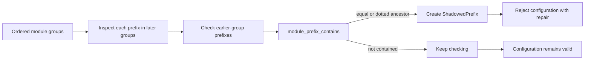
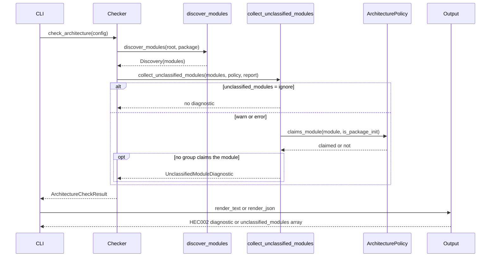

# Developers' guide

This guide records internal conventions for maintaining hecate.

## Import analysis architecture

Import analysis is a pipeline of single-purpose modules, so that parser,
namespace model, provenance, policy, and output stay separable and another
engine could replace the parser without changing the TOML policy schema. See
[ADR 001](adr-001-stdlib-ast-import-engine.md) for the decision and its limits.

| Module               | Responsibility                                                      |
| -------------------- | ------------------------------------------------------------------- |
| `source.py`          | Read and parse one scanned file, reporting `SourceError`.           |
| `imports.py`         | Discover a root's modules, and collect import statements from them. |
| `module_scope.py`    | Yield the statements that run at module scope, with nesting flags.  |
| `all_sequence.py`    | Evaluate a module's `__all__` sequence, or report it unknowable.    |
| `namespaces.py`      | Model bindings and wildcard exports per module.                     |
| `origins.py`         | Resolve an import target to the modules that supply it.             |
| `policy.py`          | Classify edges against groups, allow-lists, and ignores.            |
| `checker.py`         | Orchestrate the traversal and assemble the result.                  |
| `module_coverage.py` | Report discovered modules that no configured group claims.          |
| `diagnostics.py`     | Hold the stable, ordered diagnostic dataclasses.                    |
| `output.py`          | Render text and JSON output.                                        |

`source.py` is the only place the scanner crosses the filesystem and parser
boundary, so every failure mode of that boundary surfaces as one `SourceError`:
a path that cannot be read, bytes that are not UTF-8, or text that is not valid
Python. Both `imports.py` and `namespaces.py` parse through `parse_source`
rather than calling `ast.parse` themselves, and the CLI treats `SourceError`
like `ConfigError` and exits with its input-validation code, so a broken
checkout is reported rather than raised as a traceback.

Discovery has its own failure mode. `Path.rglob` swallows `OSError` and returns
whatever it managed to list, so an unreadable subtree would look like an empty
one and the module pass would report clean coverage of files the walk never saw.
`discover_modules` therefore walks with `Path.walk(on_error=...)` and turns a
failed listing into `DiscoveryError` naming the directory; the CLI treats that
like `SourceError` and exits 2 rather than trusting a partial tree.

`imports.py` exposes `DirectImport` and `FromImport`, plus the helpers
`compute_module_name` (dotted name for a source path under a package root) and
`relative_import_base` (absolute base for a relative import level).
`collect_import_statements` returns statements in source order, so later code
can apply Python's ordering rules; `FromImport.names` preserves `"*"` entries
verbatim, so wildcard handling is decided downstream rather than assumed here.
`discover_modules` is the one recursive walk of a package root. It returns a
`Discovery` holding the root's name and a tuple of `DiscoveredModule` records,
each pairing one `*.py` path with its dotted name and a flag saying whether it
is a package `__init__.py`, sorted by path. `check_architecture` walks every
root once, up front, and hands the same `Discovery` records to the namespace
pass, the edge pass, and the module pass, so a root is walked once per run
rather than once per pass and the three cannot disagree about which files exist.
`Discovery` carries the root's identity rather than a `PackageRoot` so
discovery stays a property of the tree and `imports.py` keeps no dependency on
the configuration model.

`module_scope.py` answers only which statements run at module scope: an `if`,
`try`, loop, `with`, or `match` body still executes at import time, so its
bindings count, while `def`, `async def`, and `class` bodies open a local scope
and are not traversed. Its nesting flag separates a statement that always runs
from one that may not, which `all_sequence.py` and `namespaces.py` read when
deciding whether a later assignment replaces an earlier one or only adds a
possibility.

`namespaces.py` is the module namespace model. `ModuleNamespace` records
`bindings` (a name may appear more than once, because a conditional rebinding
adds a candidate), the literal `__all__` sequence, and the modules a wildcard
import pulls in. `analyse_namespaces` analyses every module of the `Discovery`
records it is given, and `analyse_module` analyses one file.

`origins.py` layers provenance over that model. `build_origin_index` builds an
`OriginIndex` over already-analysed namespaces; `origins_for` maps one written
target to every module that plausibly supplies it, following re-export chains,
and `wildcard_exports` lists the concrete origins a star import would bind.
`Resolution` records how far a target was resolved: `RESOLVED`,
`UNRESOLVED_INTERNAL`, or `EXTERNAL`. An unresolved target is classified rather
than dropped, so policy can tell "no dependency exists" from "Hecate could not
tell".

`policy.py` holds the validated policy. `ModuleGroup` is a named group matched
by ordered dotted prefixes, and `first_matching_group` returns the first
configured group containing a module. `IgnoredImport` is one documented ignore;
`ignore_matches` matches both endpoints by dotted prefix. `ArchitecturePolicy`
also carries `strict`, `include_external_packages`, the severity for unresolved
internal edges, and `unclassified_modules`, which selects how a discovered
module no group classifies is reported.

`find_shadowed_prefixes` in `policy.py` defines the pure cross-group shadowing
rule; `_validate_policy` in `config.py` enforces it while loading TOML.
Policies constructed directly bypass loader validation, as they do for the
other configuration checks. Shadowing is a configuration error rather than an
opt-in flag or warning, so an unreachable group cannot silently support a green
architecture check.

**Figure: Ordered prefix validation.** For each prefix in a later group, Hecate
checks earlier groups in order. An equal or dotted-ancestor prefix shadows it
and causes configuration rejection; if no earlier prefix contains it, the
configuration remains valid.



`checker.py` orchestrates the run. `check_architecture` analyses namespaces,
builds the origin index, evaluates every statement under each package root, and
returns an `ArchitectureCheckResult` whose `ok` property is true only when
there are no violations and no coverage or unclassified-module diagnostic at
error severity. `diagnostics.py` defines `ArchitectureViolation` for a
forbidden classified edge, `CoverageDiagnostic` for an edge that could not be
fully evaluated, and `UnclassifiedModuleDiagnostic` for a discovered module no
group claims.

Two passes run per package root, and they answer different questions. The edge
pass covers the import graph: which edges exist, and whether policy permits
them. The module pass covers the policy itself: whether every discovered `*.py`
file is claimed by some group. A module no group claims is enforced over
nothing, so its edges fall outside group-based checking until the other
endpoint happens to expose them — which is why the module pass reports the
module directly, including `__init__.py` and files with no imports. It is
invoked in every mode, but under `ignore` it returns before classifying
anything and records nothing, so the default traversal does no extra work.

`module_coverage.py` owns the second pass. It reads the policy's
`unclassified_modules` mode and records an `UnclassifiedModuleDiagnostic` for
every discovered module `policy.claims_module` does not claim. Keeping the
predicate in `policy.py` and the traversal in `module_coverage.py` separates
the two questions the passes ask: `checker.py` owns discovery, namespace
analysis, and edge classification, but delegates the policy question "does some
group own this file?" to the module pass, which knows only the discovered
records and the policy. The accumulator is passed in rather than returned so
the checker's single result object stays the one place diagnostics are merged
and sorted.

Claiming is a different predicate from edge classification. `group_for` answers
"which group classifies this module?", while `claims_module` answers "is this
module inside some group's scope?". They differ for one record: a package
initializer is claimed when any configured prefix lies beneath it, because the
initializer imports and re-exports what its submodules bind. A conventional
package declared with specific groups such as `pkg.domain` thus needs no group
for `pkg` itself, and adding a recursive `pkg` group would classify every
future subpackage the module pass exists to detect. Plain modules get no
containment, so `pkg.newfeature` remains reported.

`ArchitectureCheckResult` carries `unclassified_modules` beside `violations`,
`ignored`, and `coverage`, and `ok` treats an error-severity module finding
exactly like an error-severity coverage entry. Rendering is deliberately
asymmetric across the two formats. `render_text` always prints module findings,
because the configured mode already asked for them.
`render_json(..., include_unclassified=...)` defaults to omitting the
`unclassified_modules` array, and `check` passes `True` whenever the mode is not
`ignore`. When included, the array is present even if empty, which a consumer
reads as "evaluated and clean"; under `ignore` the key is absent.

For screen readers: The following sequence diagram shows the checker running
the module-coverage pass. The checker walks each package root once through
`discover_modules`, then hands the discovered modules, the policy, and the
accumulator to `collect_unclassified_modules`. That pass first reads the
policy's `unclassified_modules` mode. Under the `ignore` mode it records
nothing and asks no further question. Otherwise it asks the policy whether each
module is claimed; only a module no group claims is recorded as an
`UnclassifiedModuleDiagnostic`. The checker returns the assembled result, and
the CLI renders it as text or JSON.



_Figure 1: Module-coverage pass from discovery through diagnostic rendering._

### Bindings and wildcard exports

These are separate concepts and must stay separate. A module **binds** a name
when it defines or imports it; `from module import name` reaches every binding.
A module **exports to wildcards** the names `__all__` selects, or its public
bindings when `__all__` is absent. `__all__` governs only the wildcard
selection: it never unbinds a name, so an explicitly imported re-export keeps
its origin even when `__all__` omits it or is set to `[]`. Filtering bindings
through `__all__` produces false negatives, letting a re-export evade a
boundary rule. A name `__all__` selects but no binding supplies stays in the
export set so normal resolution reports it unresolved, matching the
`AttributeError` Python raises.

### Required data flow

`check_architecture` in `checker.py` fixes this order, and later stages assume
it:

1. Discover each package root's modules (`imports.py`). This is the only
   recursive walk, and every later stage reads the same `Discovery` records.
2. Analyse those modules' namespaces, bindings, and wildcard selection
   (`namespaces.py`, over `module_scope.py` and `all_sequence.py`). This pass
   is what reads and parses each file, through `source.py`.
3. Build the origin index over those namespaces (`origins.py`), so provenance
   is derived from the model rather than from a second parse of the tree.
4. Collect import statements from each discovered file (`imports.py`, parsing
   through `source.py` again), and resolve named and wildcard edges against the
   index.
5. Classify each edge against policy, honouring ignores first (`policy.py`),
   and separately record every discovered module no group claims
   (`module_coverage.py`).
6. Assemble `ArchitectureCheckResult`, then render it (`diagnostics.py`,
   `output.py`).

Source parsing supports both the namespace pass and the import-collection pass,
so parsing is not a step that must happen before namespace analysis; the same
`parse_source` boundary serves each caller. Discovery is likewise a stage of
its own rather than a walk repeated inside each pass: it fixes the set of files
under a root once, so no two passes can see different trees.

Skipping or reordering a stage leaves edges unexamined, which the coverage
model reports rather than hides: each in-scope edge receives exactly one of
`permitted`, `forbidden`, `exempted`, `unclassified`, or `unresolved`. A green
result means no forbidden violation was found and no coverage diagnostic
carried error severity — not that every edge was understood.
`coverage_severity` reports unclassified and unresolved edges as warnings
outside strict mode, and as errors under it (with unresolved internal edges
using the configured `unresolved_internal_severity`). A non-strict run can
therefore pass while those warnings are still recorded; JSON always carries the
coverage section, and text output shows the warnings under `--show-coverage`
(entries that fail the check are always shown). An unmatched ignore fails the
run separately at exit code 2, but only under `--fail-on-unmatched-ignore`.

`hecate/reexports.py` no longer exists. Its responsibilities are now split
between `namespaces.py` (bindings and wildcard selection) and `origins.py`
(provenance over them). See the
[users' guide](users-guide.md#re-export-handling) for the observable behaviour
and [configuration](configuration.md) for the policy schema.

## Coverage workflow contract

`make test-workflow-contracts` runs `cv005-contracts check`, the shared
contract library in `leynos/shared-actions`, from the full commit named by
`CV005_CONTRACTS_REF` in the Makefile; `make test` and `make all` depend on it
and CI runs it in its own step. It needs `uv`, which fetches the Python 3.13
the library runs under, and `.github/cv005.toml` holds the repository's
parameters. A fix to a rule reaches this repository as a pin bump. The
local-validation guide and
[ADR 002](adr-002-adopt-the-shared-cv005-contract-library.md) record the rules
and the decision, and `tests/workflow_contracts/test_cv005_wiring.py` holds the
local wiring.

Both coverage lanes set up Python 3.14 with `actions/setup-python`, inside the
project's `requires-python` (`>=3.14`). generate-coverage chooses its
interpreter from its `python-version` input, then `UV_PYTHON`, then
`.python-version`, then the `python3` on `PATH`, which is the most recent
`setup-python` step before the call in its job; `uv sync` refuses an
interpreter outside `requires-python`.
`tests/workflow_contracts/test_coverage_python_version.py`, with its reader in
`tests/workflow_contracts/coverage_python_sources.py`, requires every
generate-coverage call in the pull-request lane and the publisher to declare at
least one of those sources, every declared source to name the same version,
that version to be inside `requires-python`, and both lanes to measure on that
one version. A `setup-python` step guarded by `if:` or allowed to fail with
`continue-on-error` declares nothing. The ratchet baseline key already carries
the interpreter (`ratchet-baseline-<os>-py<major.minor>-`), so a lane on
another Python would miss its baseline rather than compare against the wrong
one; the contract turns that silent restart into a failure. It uses
`packaging`, a development dependency, and stays a local contract: the shared
CV-005 library holds the interpreter only through an opt-in `UV_PYTHON` pin
that these lanes do not use.

## Linting

Run the complete local lint gate with:

```shell
make lint
```

The target runs Ruff and the managed-PyPy Pylint checks, then performs a
blocking Skylos scan for dead production code in `hecate`. Continuous
integration runs the same `make lint` target, so an unexplained Skylos finding
blocks both local commits and pull requests.

Skylos is provisioned independently at the version pinned in the Makefile. Its
command-only macro runs it under Python 3.14 because Skylos parses source using
its own runtime AST; the pinned runtime prevents phantom findings when the
project uses newer Python syntax. The scan-only macro adds the reviewed
`pyproject.toml` configuration. The scan is limited to dead-code analysis and
neither uploads code nor collects provenance.

Treat each finding as dead code until a runtime caller has been verified.
Remove genuine dead code. When static analysis cannot see an intentional
runtime reference, prefer a narrow, typed entry point in `pyproject.toml`:

```toml
[[tool.skylos.dead_code.entrypoints]]
type = "method"
full_name = ["hecate.module.Class.method"]
reason = "Verified runtime caller."
```

The entry point's fully qualified name and type must identify only the verified
runtime boundary. Use `[tool.skylos.whitelist.documented]` only when no entry
point can describe that boundary. Add a named exception with:

```shell
make skylos-allow SYMBOL=handler REASON="Loaded by plugin registry"
```

The target requires both values to contain at least one non-whitespace
character. Use `SYMBOL`, not `NAME`: Windows Subsystem for Linux injects `NAME`
with the hostname. It dispatches `skylos whitelist` before the symbol and
reason, then records the reason in Skylos's documented allow list. Do not add
broad exceptions or baselines; retain the verified runtime caller's evidence in
the reviewing change and remove an exception when its runtime boundary no
longer exists. The helper holds an ignored repository-local
`.skylos-whitelist.lock` with `flock` while Skylos updates the allow list, so
concurrent contributors cannot interleave its read-modify-write operation.

The Makefile contracts are parsed by the pinned `makeutil` executable in
`tests/test_skylos_lint_contract.py`; `tests/test_skylos_allow_contract.py`
uses a temporary recorder to verify exact shell argument forwarding without
editing `pyproject.toml`. `make test` verifies that the parser is available
before running the test suite. CI installs the same pinned Makeutil revision
before each full pytest suite. To bootstrap that parser locally, run:

```shell
rustup toolchain install nightly-2026-05-28 --profile minimal
RUSTFLAGS="-Zpolonius=next" cargo +nightly-2026-05-28 install \
  --git https://github.com/leynos/makeutil \
  --rev 29fc5a1634ffbaa18a773eed9dff1b2838a45d9c \
  --locked --force makeutil
make test
```

## Markdown formatting and lint

`make fmt` rewrites the Markdown files Git tracks, plus untracked files it does
not ignore, with `mdtablefix --in-place`, then runs `markdownlint-cli2 --fix`.
`make check-fmt` runs `mdtablefix --check` over the same selection with the
same rewrite flags (`MDTABLEFIX_SELECT` and `MDTABLEFIX_RULES` in the
`Makefile`). `make markdownlint` lints the Markdown files selected by the glob
and the ignore rules in `.markdownlint-cli2.jsonc`. Both `mdtablefix` (0.6.1 or
later) and `markdownlint-cli2` must be on `PATH`. CI installs `mdtablefix`
0.6.1 through the shared `install-mdtablefix` action and lints through the
pinned `markdownlint-cli2-action`. `.markdownlint-cli2.jsonc` holds the rules,
the ignores and `"gitignore": true`.
